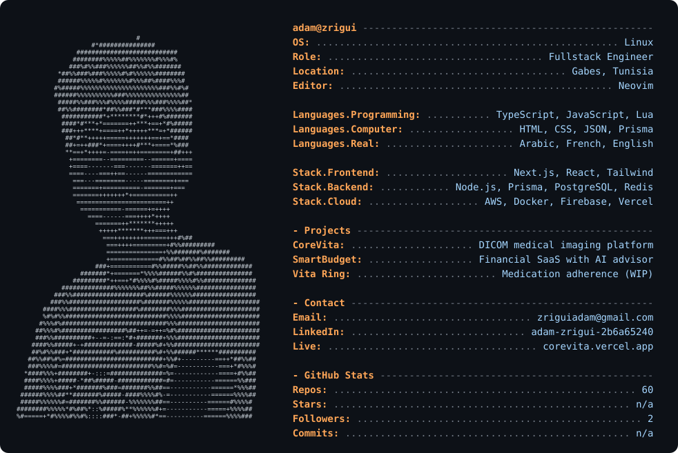

  <picture>
    <source media="(prefers-color-scheme: dark)" srcset="dark_mode.svg">
    <source media="(prefers-color-scheme: light)" srcset="light_mode.svg">
    
  </picture>

---

## About

Fullstack engineer specializing in production SaaS and healthtech platforms.
I build end-to-end systems — from database schema to deployment — using modern TypeScript ecosystems (Next.js, Prisma, Tailwind, Node.js).
I ship products. I iterate. I optimize.

---

## Current Work

- **CoreVita** — enterprise DICOM medical imaging platform (RBAC, audit logs, Stripe, BullMQ, Redis, AWS S3) → [corevita.vercel.app](https://corevita.vercel.app)
- **Vita Ring** — medication adherence platform with wearable biometric correlation (in progress)
- **SmartBudget** — full-stack financial SaaS with AI advisor → [smart-budget-rho.vercel.app](https://smart-budget-rho.vercel.app)

---

## Stack

---

## Contact

- Email: <zriguiadam@gmail.com>
- LinkedIn: [linkedin.com/in/adam-zrigui-2b6a65240](https://www.linkedin.com/in/adam-zrigui-2b6a65240/)
- Live: [corevita.vercel.app](https://corevita.vercel.app)
